# System Architecture & Design Decision Log

## 1. System Topology & Cost Funnel

```mermaid
flowchart TD
    subgraph Intake ["1. Intake & Taxonomy Stage"]
        CV["Candidate CV (PDF/DOCX)"] --> IntakeAgent["IntakeAgent\n(src/agents/intake.py)"]
        IntakeAgent --> Profile["UserProfile\n(Candidate-Agnostic)"]
        Profile --> TaxonomyGen["Taxonomy Generator\n(src/taxonomy.py)"]
        TaxonomyGen --> Taxonomy["data/taxonomy.json\n(Roles, Skills, Regex)"]
    end

    subgraph Registry ["2. Company Registry Stage"]
        Taxonomy --> RegistryPop["Registry Population\n(ATS Slugs & Curated Sources)"]
        RegistryPop --> CompaniesDB[("companies table\n(Domain, ATS, Slug)")]
    end

    subgraph Harvest ["3. Cost-Funnel Job Harvest"]
        CompaniesDB --> BoardFetch["1. Fetch Entire Board\n(0 LLM Tokens)"]
        BoardFetch --> TitleRegex["2. Title Regex Filter\n(Word-Boundary Regex)"]
        TitleRegex --> HardFilters1["3. Hard Filters\n(Country, Seniority, Internships)"]
        HardFilters1 --> FetchDesc["4. Fetch Description\n(Shortlisted Jobs Only)"]
        FetchDesc --> HardFilters2["5. Second Hard Filter\n(Visa, ITAR, Citizenship)"]
        HardFilters2 --> Classifier["6. LLM Scoring\n(<5% Surviving Shortlist)"]
    end

    subgraph Verify ["4. Independent Verification Stage"]
        Classifier --> DetChecks["1. Deterministic Checks\n(HTTP Status, ATS ID, Verbatim Quote)"]
        DetChecks --> StillOpen["2. Multilingual Still-Open Check\n(EN/DE/FR/NL/ES/IT)"]
        StillOpen --> LLMAudit["3. Adversarial LLM Audit\n(Sampled + Borderline Scores)"]
    end

    subgraph Output ["5. Orchestration & Export Stage"]
        LLMAudit --> ManagerAgent["Manager Agent\n(Quality Gates & Budgets)"]
        ManagerAgent --> ExcelExport["SheetsSyncManager\n(Single Owner: data/exports/job_hunt_results.xlsx)"]
        ExcelExport --> ExcelFile["Multi-Sheet Excel Workbook\n(Metrics, Verified, Ineligible, Logs)"]
    end
```

---

## 2. Decision & Trade-offs Log

### A. Cost Funnel (Cheap $\rightarrow$ Expensive) vs. Direct LLM Evaluation
* **Decision:** Ingest full ATS boards with zero LLM tokens. Apply word-boundary regex title filters, country resolution, and hard filters *before* fetching descriptions or calling the LLM.
* **Trade-off:** Requires robust regex patterns and a structured search taxonomy.
* **Why it was chosen:** Calling an LLM on every open job across 100,000+ companies would cost thousands of dollars and trigger severe rate limits. The funnel eliminates $>95\%$ of irrelevant jobs for free.

### B. Independent Adversarial Verifier vs. Self-Auditing
* **Decision:** The Verifier agent evaluates raw page text and candidate claims *without* seeing the Classifier's reasoning.
* **Trade-off:** Evaluates postings twice (once for fit, once for truth).
* **Why it was chosen:** Language models suffer from confirmation bias when asked to audit their own generated rationale. Presenting the raw page text adversarially guarantees that claims, quotes, and work modes are genuinely grounded in reality.

### C. SQLite State Store with WAL Mode vs. Direct In-Memory or Sheet Writes
* **Decision:** SQLite with WAL mode, busy timeouts, and atomic task claims as the transactional truth.
* **Trade-off:** Requires a dedicated export pass to produce final spreadsheets.
* **Why it was chosen:** SQLite provides ACID guarantees, lease recovery on crash (`kill -9` resilient), zero API costs, and seamless parallel read/write concurrency.

### D. Candidate-Agnostic Engine vs. Hardcoded Assumptions
* **Decision:** All matching rules, seniority enums, and queries are derived from the candidate's parsed `UserProfile` and `data/taxonomy.json`.
* **Trade-off:** Requires structured validation for profile ingestion.
* **Why it was chosen:** Enables the system to serve any engineering discipline or candidate profile seamlessly without altering source code.
